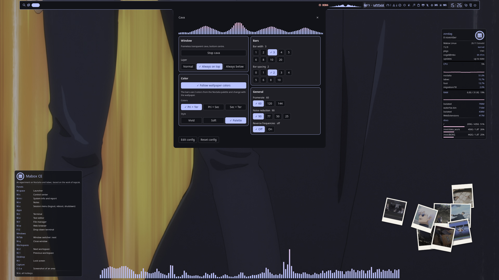
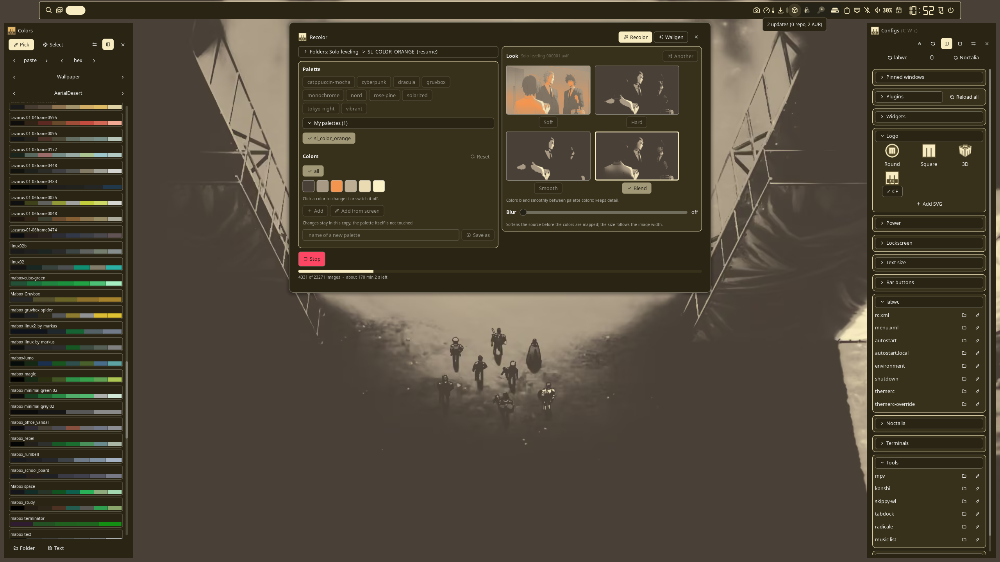
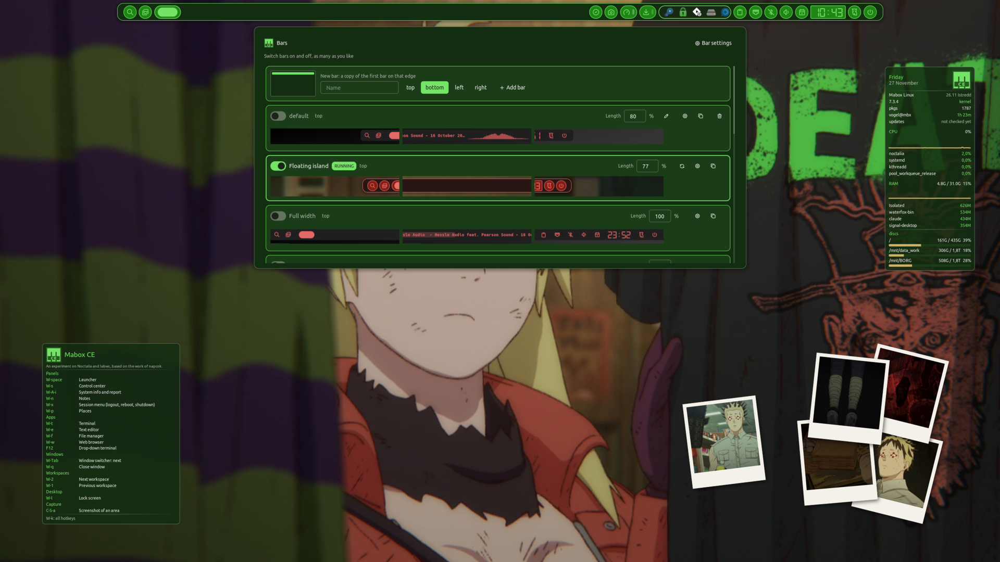
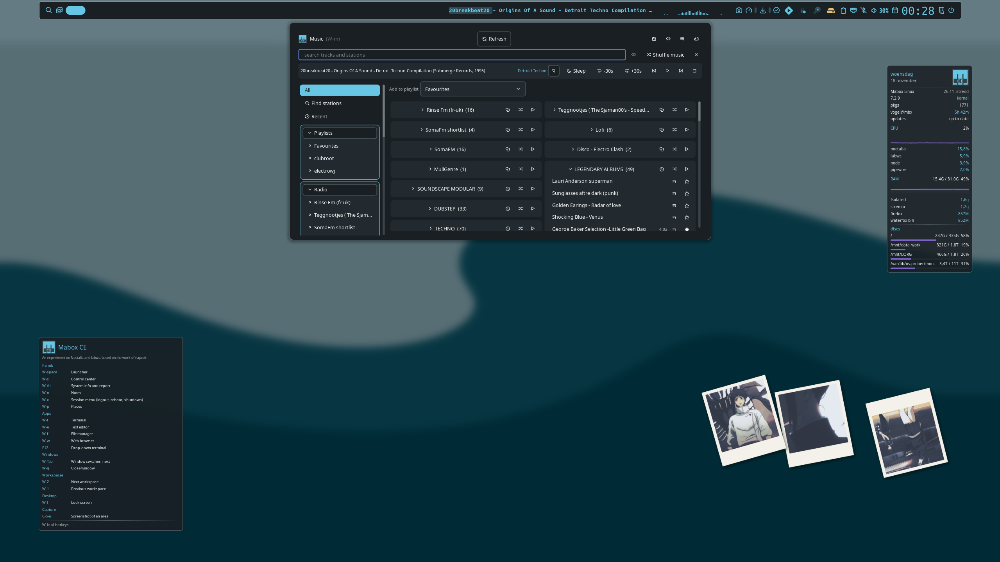
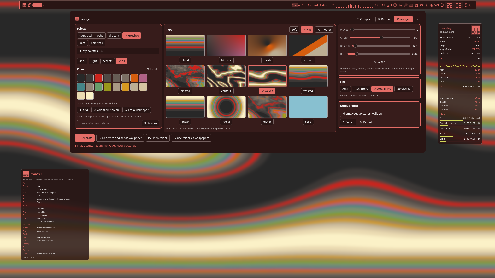

  

# [mabox-noctalia-ce](https://musqz.github.io/mabox-noctalia-ce/intro.html)

### Noctalia session on labwc for Mabox Linux Community Edition. Available from Mabox repo.

_Work in progress: features, keys and docs change. Expect bugs._

## Install

Needs Mabox Linux and `noctalia` 5.4 or newer (repo `[maboxlinux]`).

```sh
sudo pacman -S mabox-noctalia-ce
```
- Git is the latest. Use git for latest features and fixes.

From git:

```sh
git clone https://github.com/musqz/mabox-noctalia-ce
cd mabox-noctalia-ce
./install.sh
```

- Installs the missing packages and builds `mabox-noctalia-ce`.
- Skips packages you already have; rebuilds `mabox-noctalia-ce` on every run.
- Ends with a `[done]` / `[skip]` / `[todo]` summary.
- Config lives in `~/.config/mabox-noctalia-ce/`. Other sessions are not touched.

Coming from Mabox Openbox on the same account? After the install:

- The Mabox todo lists and the CE Todo panel use the same files in `~/.todo`: a task added in one shows in the other. There is nothing to sync.
- Copy the rest of the Mabox todo setup once. Run `--dry-run` first to see what it would do:

```sh
mb-import-openbox --dry-run
mb-import-openbox
```

- Details: [manual](https://musqz.github.io/mabox-noctalia-ce/guide.html#import-from-mabox-openbox).

## Update

Repo install: `sudo pacman -Syu`.

Git install:

```sh
cd mabox-noctalia-ce
git pull
./install.sh
```

- Run each `meld` line listed under `[todo]` and merge what you want.
- Apply the merged config: `labwc --reconfigure`.
- Log out and back in after changes to `environment` or the plugins.

## Remove

Repo install: `sudo pacman -R mabox-noctalia-ce`.

Git install:

```sh
./install.sh --uninstall
rm -rf ~/.config/mabox-noctalia-ce
```

`--uninstall` removes the package and the packages the script installed.

## Docs

- [docs/guide.md](docs/guide.md): configs, system info, bar, menu, capture, wallpaper, power.
- [docs/keys.md](docs/keys.md): hotkeys and the Keys panel.
- [docs/tools.md](docs/tools.md): panels, desktop widgets, music and scripts.
- [docs/snapshot.md](docs/snapshot.md): build an ISO, then USB or VM.
- [docs/bars.md](docs/bars.md): switch bars on and off, set their length and start from shipped bars.
- [docs/music.md](docs/music.md): music panel, playlists and media keys.
- [docs/technical/](docs/technical/): files, paths, commands and config files.

## Screenshots

<table>
<tr>
<td><a href="docs/desktop-2.png"></a></td>
<td><a href="docs/desktop-recolor.png"></a></td>
</tr>
</table>

<table>
<tr>
<td><a href="docs/desktop-bars.png"></a></td>
</tr>
</table>

<table>
<tr>
<td><a href="docs/music-panel.png"></a></td>
<td><a href="docs/wallgen-panel.png"></a></td>
</tr>
</table>
