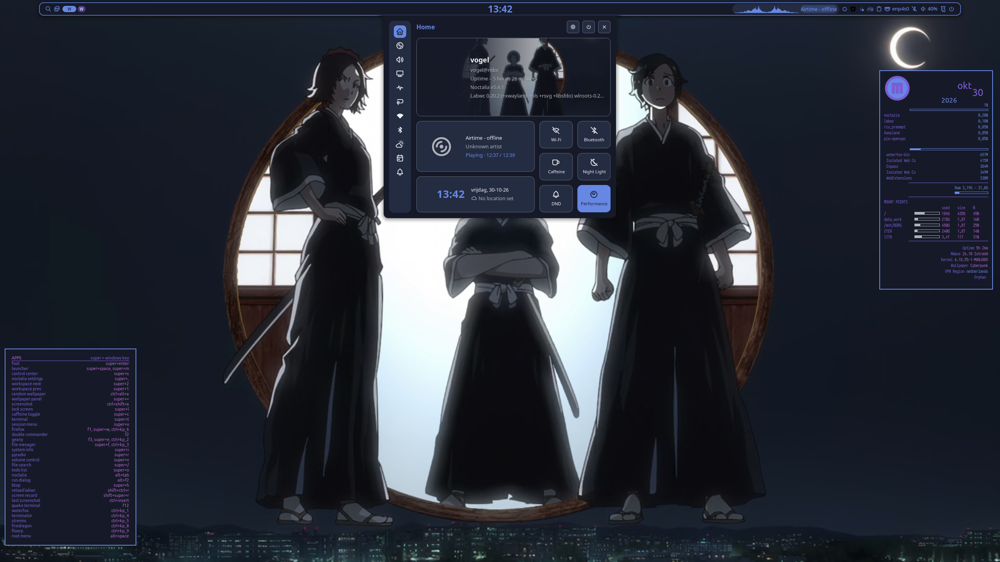
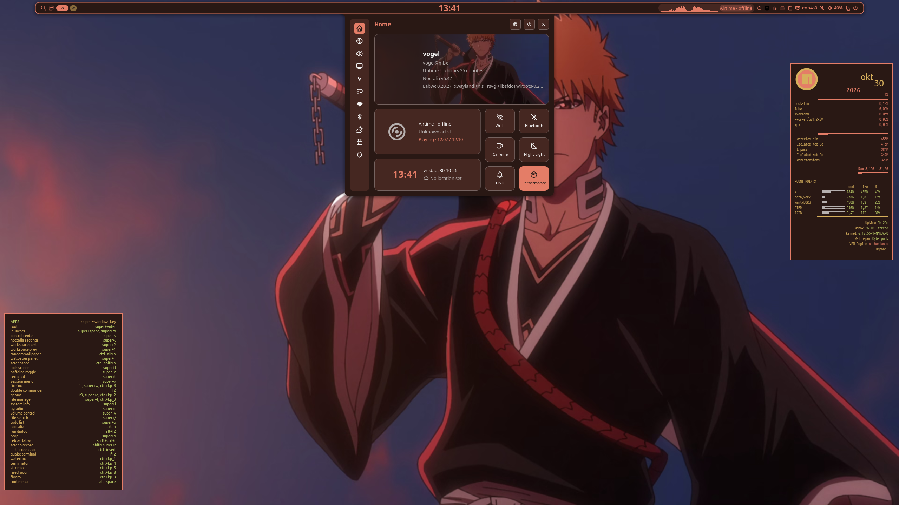
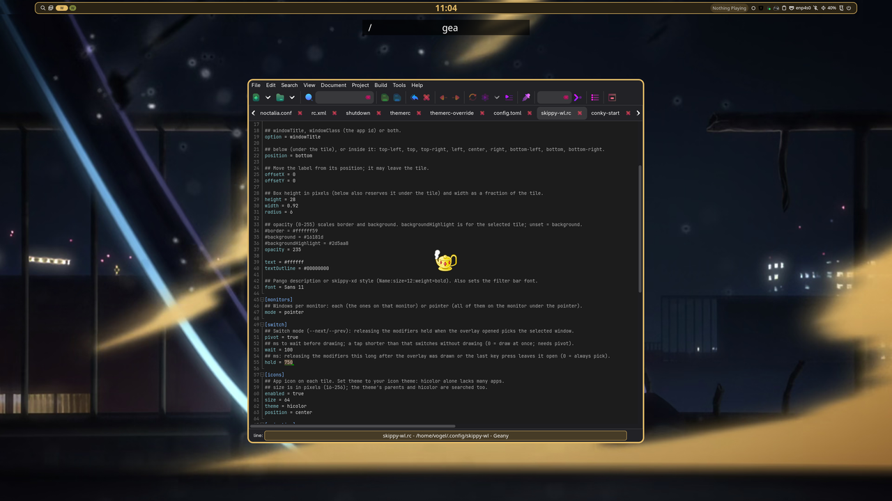
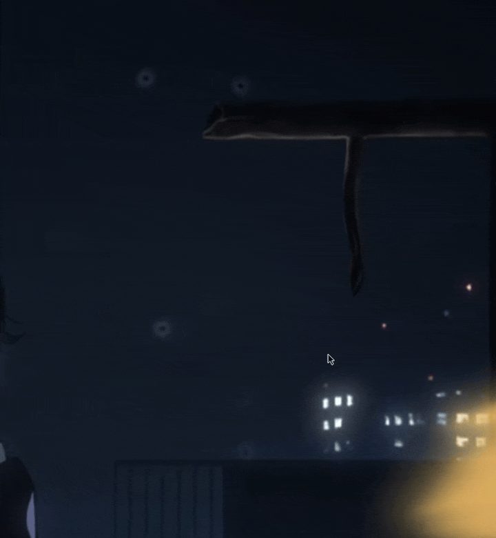
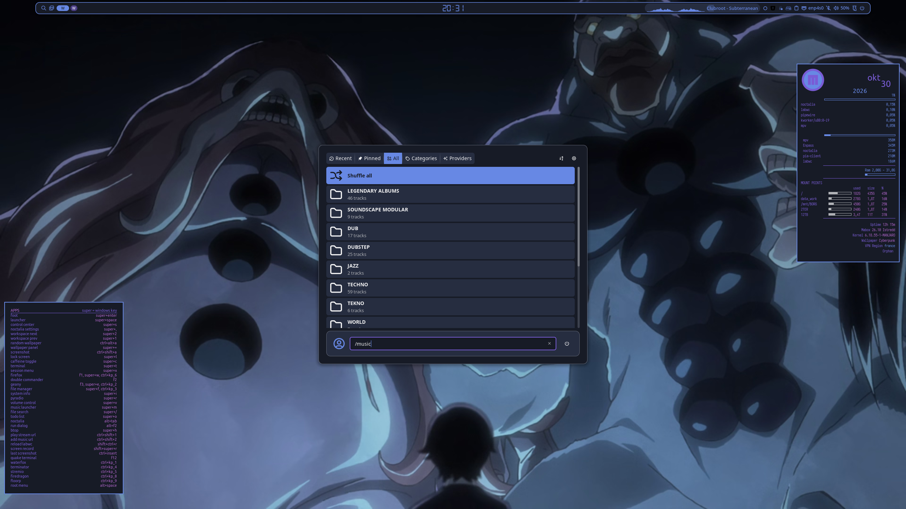
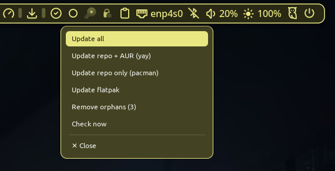
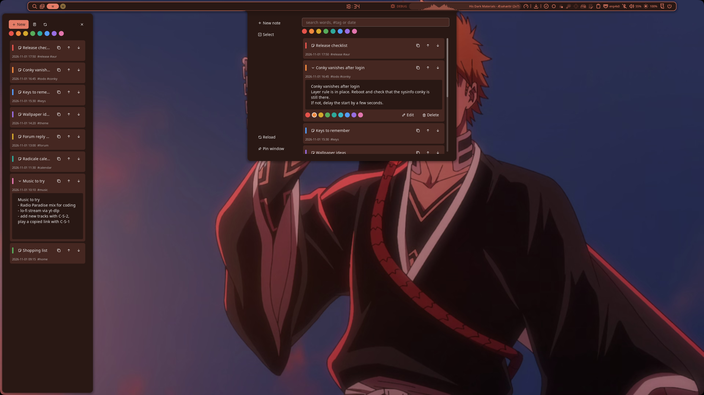
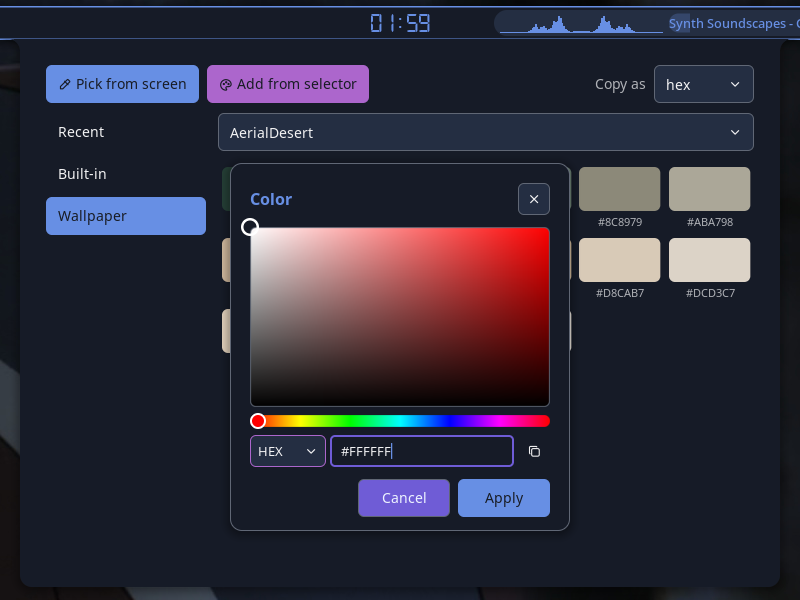
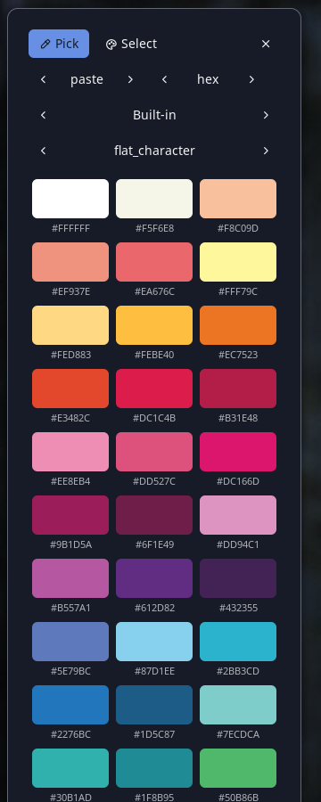

# mabox-noctalia-ce

Noctalia session on labwc for Mabox Linux. Pick **Noctalia CE** at the login screen. It differs from the original mabox-noctalia in config, scripts and packages.

**Screenshots:** [Themes](#themes) · [Windows and menus](#windows-and-menus) · [Launcher and bar panels](#launcher-and-bar-panels) · [Notes and colors](#notes-and-colors)

Work in progress. Take what you like, or install it as is.

## Install

Needs Mabox Linux and `noctalia` 5.4 or newer (repo `[maboxlinux]`).

```sh
git clone https://github.com/musqz/mabox-noctalia-ce
cd mabox-noctalia-ce
./install.sh
```

- Installs the missing packages and builds `mabox-noctalia-ce`.
- Skips packages you already have; rebuilds when `bin/` differs from `/usr/bin`.
- Ends with a `[done]` / `[skip]` / `[todo]` summary.
- Config lives in `~/.config/mabox-noctalia-ce/`. Other sessions are not touched.

## Autostart

Add your own programs, one per line:

```sh
echo 'myapp &' >> ~/.config/mabox-noctalia-ce/autostart.local
```

`autostart` stays the shared default.

## Remove

```sh
./install.sh --uninstall
rm -rf ~/.config/mabox-noctalia-ce
```

`--uninstall` removes the package and the packages the script installed.

## Screenshots

Click an image for the full size.

### Themes

<table>
  <tr>
    <td valign="top"><a href="docs/theme-blue-2.png"></a></td>
    <td valign="top"><a href="docs/theme-red-2.png"></a></td>
  </tr>
  <tr>
    <td align="center">Blue theme with matching conky</td>
    <td align="center">Red theme with matching conky</td>
  </tr>
</table>

### Windows and menus

<table>
  <tr>
    <td valign="top"><a href="docs/skippy-wl-search.png"></a></td>
    <td valign="top"><a href="docs/skippy-wl.png"></a></td>
  </tr>
  <tr>
    <td align="center">skippy-wl: <code>/</code> search</td>
    <td align="center">skippy-wl: expose view of all windows</td>
  </tr>
</table>

<table>
  <tr>
    <td valign="top"><a href="docs/skippy-wl-multiselect.png"></a></td>
    <td valign="top"><a href="docs/root-menu.gif"></a></td>
  </tr>
  <tr>
    <td align="center">skippy-wl: multiselect</td>
    <td align="center">Root menu with icons</td>
  </tr>
</table>

### Launcher and bar panels

<table>
  <tr>
    <td valign="top"><a href="docs/music-launcher.png"></a></td>
    <td valign="top"><a href="docs/updates-menu.png"></a></td>
  </tr>
  <tr>
    <td align="center">/music launcher</td>
    <td align="center">Update menu</td>
  </tr>
</table>

### Notes and colors

<table>
  <tr>
    <td valign="top"><a href="docs/notes.png"></a></td>
  </tr>
  <tr>
    <td align="center">Notes (W-n) and pinned window (W-A-n)</td>
  </tr>
</table>

<table>
  <tr>
    <td valign="top"><a href="docs/colors-dropdown.png"></a></td>
    <td valign="top"><a href="docs/colors-pinned.png"></a></td>
  </tr>
  <tr>
    <td align="center">Colors panel (W-A-c)</td>
    <td align="center">Pinned window</td>
  </tr>
</table>

## Guide

Elements, keys and tips: [docs/guide.md](docs/guide.md).

## Custom tools

| Tool | Key | Setup |
|---|---|---|
| `/music` launcher player | `W-m` | [docs/music.md](docs/music.md) |
| `mb-music-add-url` add track | `C-S-2` | [docs/music.md](docs/music.md) |
| `mb-updates-ce` bar update indicator | left: update menu, right: recheck | autostart |
| `mb-calendar-setup` local calendar (radicale) | run once in a terminal | Thunderbird + Noctalia Settings > Calendar > Local (vdir) |
| `mb-colorpick` + Colors bar panel | bar button: pick from screen, recent colors, palettes | `~/.config/colormenu/*.clr` |
| Notes panel: notes with colors | `W-n`, pinned window `W-A-n` | `~/.local/state/noctalia/plugins/data/musqz/notes/path`: one line, folder to sync (optional) |
| `mpv-play-stream` play URL | `C-S-1` | [docs/music.md](docs/music.md) |
| Media keys | `XF86Audio*` | [docs/music.md](docs/music.md) |
