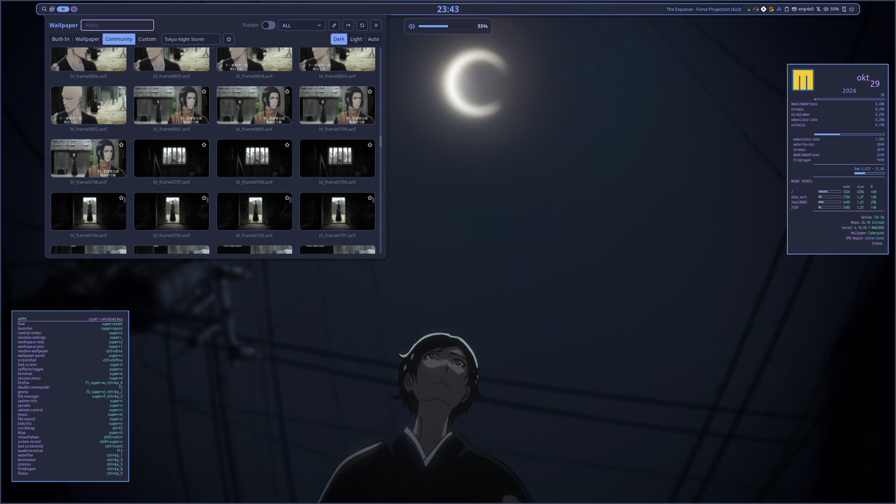
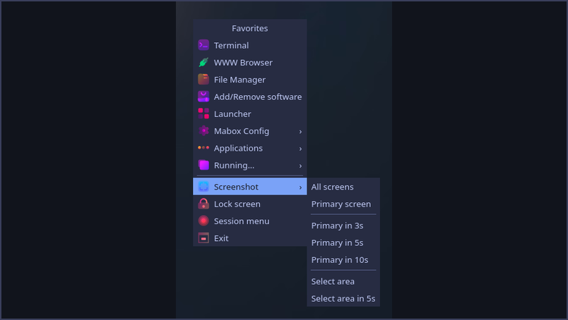
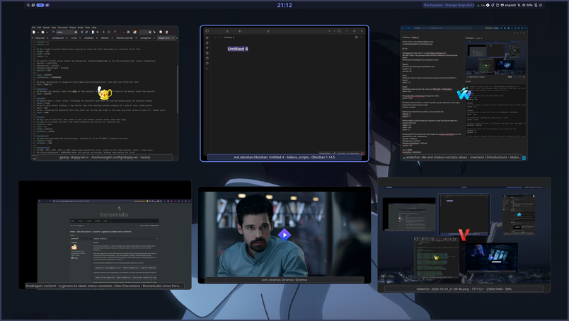
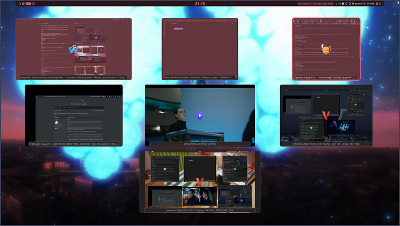

# mabox-noctalia-ce

musqz's community edition of Mabox Noctalia: a [Noctalia](https://github.com/noctalia-dev/noctalia-shell) session on labwc, selectable as **Noctalia CE** at the login screen. It differs from the original mabox-noctalia in config, scripts and package choices.

**Work in progress.** This repo is for inspiration and development: take what you like, or install it as is.

- **Separate:** own session entry and own config in `~/.config/mabox-noctalia-ce/`. Other sessions are not touched.
- **Install:** `./install.sh` installs the needed packages and builds the `mabox-noctalia-ce` package. Packages you already have are skipped.
- **Remove:** `./install.sh --uninstall` removes the package and the packages the script installed. Then `rm -rf ~/.config/mabox-noctalia-ce`.

Requires Mabox Linux with `noctalia` 5.4 or newer (repo `[maboxlinux]`).

<table>
  <tr>
    <td></td>
    <td></td>
    <td></td>
  </tr>
  <tr>
    <td align="center">Root menu with icons</td>
    <td align="center">skippy-wl: expose view of all windows</td>
    <td align="center">skippy-wl: multiselect</td>
  </tr>
</table>
