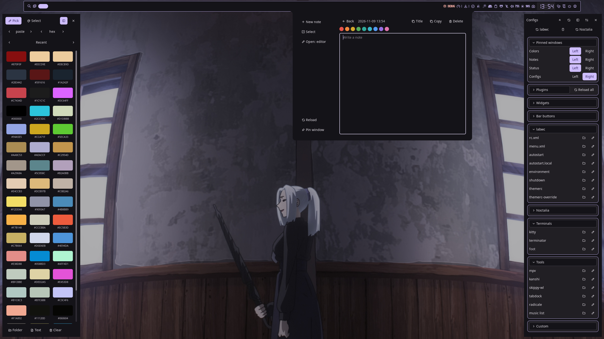
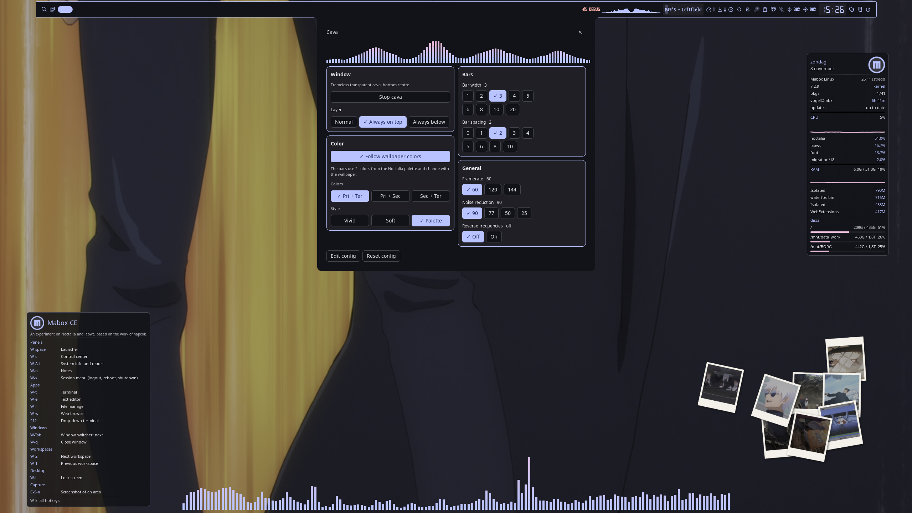
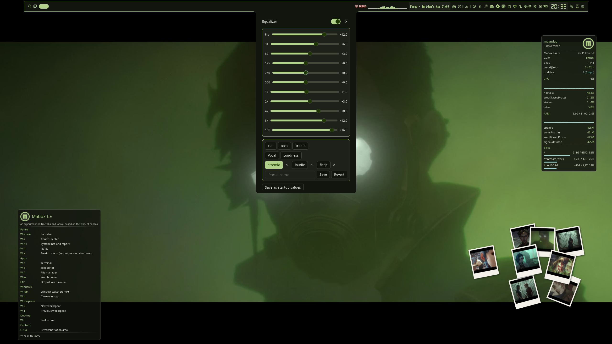

# mabox-noctalia-ce

Noctalia session on labwc for Mabox Linux. Pick **Noctalia CE** at the login screen. It differs from the original mabox-noctalia in config, scripts and packages.

Work in progress: features, keys and docs change. Expect bugs. Take what you like, or install it as is.

## Install

Needs Mabox Linux and `noctalia` 5.4 or newer (repo `[maboxlinux]`).

From the Mabox repo (no git needed):

```sh
sudo pacman -S mabox-noctalia-ce
```

- The repo build lags behind: Daniel builds it by hand and cannot update often.
- Git is always the latest. While the project changes this fast, use git for new features and fixes.

From git:

```sh
git clone https://github.com/musqz/mabox-noctalia-ce
cd mabox-noctalia-ce
./install.sh
```

- Installs the missing packages and builds `mabox-noctalia-ce`.
- Skips packages you already have; rebuilds `mabox-noctalia-ce` on every run.
- Ends with a `[done]` / `[skip]` / `[todo]` summary.
- Config lives in `~/.config/mabox-noctalia-ce/`. Other sessions are not touched.
- Several monitors: panels can open on the wrong screen until `noctalia` ships the fix ([PR 5173](https://github.com/noctalia-dev/noctalia/pull/5173)). One screen is not affected.

## Update

Repo install: `sudo pacman -Syu`.

Git install:

```sh
cd mabox-noctalia-ce
git pull
./install.sh
```

- Run each `meld` line listed under `[todo]` and merge what you want.
- Apply the merged config: `labwc --reconfigure`.
- Log out and back in after changes to `environment` or the plugins.

## Remove

Repo install: `sudo pacman -R mabox-noctalia-ce`.

Git install:

```sh
./install.sh --uninstall
rm -rf ~/.config/mabox-noctalia-ce
```

`--uninstall` removes the package and the packages the script installed.

## Docs

- [docs/guide.md](docs/guide.md): bar, theme, menu, monitors, tips.
- [docs/keys.md](docs/keys.md): hotkeys and the Keys panel.
- [docs/tools.md](docs/tools.md): panels, desktop widgets, music and scripts.
- [docs/snapshot.md](docs/snapshot.md): build an ISO, then USB or VM.
- [docs/music.md](docs/music.md): music launcher and media keys.
- [docs/overview.md](docs/overview.md): files, paths and tools.

## Screenshots

<a href="docs/desktop.png"></a>

<a href="docs/desktop-2.png"></a>

<a href="docs/equalizer.png"></a>
