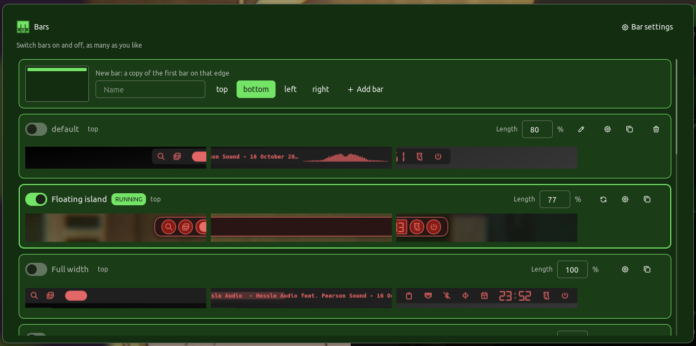

# Bars

The bar is the strip with the launcher, workspaces, tray and clock. The Bars panel lists every bar, switches each one on or off and sets its length.

| Open | |
|---|---|
| launcher | `/bars` |
| root menu | *Bars* |
| Configs panel | the bars button on the `bar.toml` row |

## Switch bars on and off

1. Open the Bars panel.
2. Press the switch on a bar. A bar that is on shows **RUNNING**.

- Switch on as many bars as you like, or none.
- Bars on the same edge lie on top of each other.
- The small screen at the top of the list shows where the bars that are on sit.
- Panels that hang on a bar, such as the control center and the Capture panel, hang on a bar that is on. Switch that bar off and they move to the next bar that is on. The choice is *Anchor Bar* in the Noctalia settings under Panels.

## The shipped bars

Five bars come with the session, all off. They have your buttons with another shape:

- **Floating island**: a solid rounded bar, shorter than the screen.
- **Full width**: a solid flat bar over the whole edge.
- **Transparent round**: no bar background, round buttons.
- **Transparent plain**: no bar background, no buttons, only icons.
- **Transparent outline**: no bar background, buttons with a border line.

You cannot rename or delete these. To change one, copy it and change the copy.

## Length

Type a number from 10 to 100 in the **Length** field and press Enter. 100 is the whole edge of the screen, 80 leaves 10 percent free at both ends.

## Add, copy, rename and delete

- **New bar**: type a name, choose the edge, press **Add bar**. The new bar is a copy of the first bar.
- The copy button makes a copy of a bar.
- The pencil renames a bar.
- The trash button deletes a bar. Press it twice.

## Change a bar

The gear button on a bar opens Noctalia's bar settings: colors, shape and buttons. Buttons of the first bar are also in the Configs panel, see [Change a bar button](guide.md#change-a-bar-button).

## Pictures

Each bar shows its left, middle and right part. Press the refresh button on a bar that is on to take a new picture. Bars on the same edge show the same picture: switch one on, take the picture, then the next.
