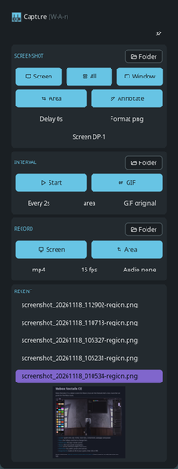

# Screenshots and recording

`W-A-r` opens the Capture panel: screenshots, recording, interval shots and the recent files.

| Key | Does |
|---|---|
| `C-S-a` | screenshot of an area |
| `C-Insert` | open the last screenshot |
| `W-S-r` | record an area; press again to stop |
| `W-S-x` | stop a recording and interval shots |

## Screenshot

- *Screen*, *All* (every monitor), *Window*, *Area* and *Annotate* take the shot. *Window* shows a picker: click the windows you want, press `Enter`.
- *Delay* waits 0 to 30 seconds first. *Format* is png, jpg, webp or avif.
- The bottom row picks the monitor for the *Screen* button.

## Record

- *Screen* records a monitor, *Area* records the part you select. With several monitors, *Screen* asks you to click one.
- Choose mp4 or mkv, 15, 30 or 60 fps, and the sound: none, system or microphone.
- While you record, the camera in the bar is a red dot:

| Click | Does |
|---|---|
| left | <i class="ti">&#xED4A;</i> stop |
| right | <i class="ti">&#xED45;</i> pause; click again to resume |

## Interval

- *Start* takes a screenshot every few seconds, of an area or a monitor; *Stop* ends it. While it runs, the camera <i class="ti">&#xEA54;</i> in the bar is a red dot <i class="ti ti-rec">&#xF671;</i>: a left click stops it.
- *GIF* turns the images into an animation. *Backup* moves them to a dated folder; *Delete all* removes them (click twice).

The folder icons next to the headings open the folders with your files.

## Settings

The gear <i class="ti">&#xEB20;</i> at the top opens the settings. Set the folder for screenshots, recordings, interval screenshots and GIF animations: type a path or press *Browse*. Empty uses the default folder. The arrow takes you back.
