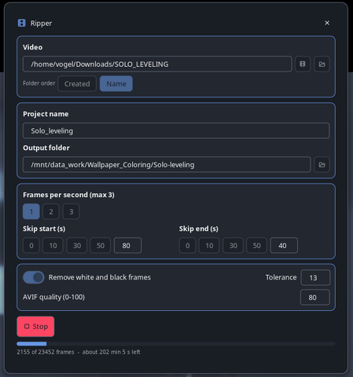

# Custom plugins

Plugins made by users, not shipped with Mabox Noctalia CE. Each one has its own repo and is added as a plugin source.

Add a plugin:

1. Clone the repo: `git clone <repo-url> ~/Github/<name>`
2. Add it as a source: `noctalia msg plugins source add <name> path ~/Github/<name>`
3. Enable it: `noctalia msg plugins enable <plugin-id>`
4. Open its panel: `noctalia msg panel-toggle <plugin-id>:<panel>`

Update: `git pull` in the clone, then `noctalia msg plugins disable <plugin-id>` and `enable` again.

## Ripper

Turns a video, or a folder of videos, into AVIF frames. Made for wallpapers and for the [Recolor](tools.md) panel.

<p align="center"><a href="img/ripper.png"></a></p>

Repo: [github.com/musqz/musqz-ripper](https://github.com/musqz/musqz-ripper)

Needs `ffmpeg` (with libaom), `yad` and `libnotify`.

```
git clone git@github.com:musqz/musqz-ripper.git ~/Github/musqz-ripper
noctalia msg plugins source add musqz-ripper path ~/Github/musqz-ripper
noctalia msg plugins enable musqz/ripper
noctalia msg panel-toggle musqz/ripper:main
```

1. Pick a video (movie button) or a folder (folder button). A folder is read by creation date or by name.
2. Set the project name and the output folder.
3. Set frames per second (1-3) and the seconds to skip at the start and end of every video.
4. Switch *Remove white and black frames* on or off.
5. Press *Start*. A season can take hours; a notification follows when it is done.

Frames land in `<output>/<project>/avif/`. An existing project folder is never overwritten; the next run gets `-2`.
