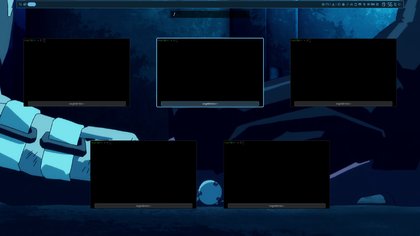
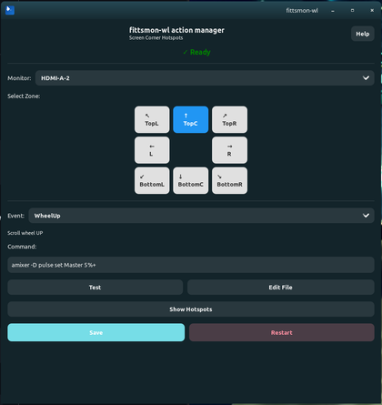
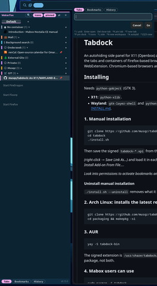

# External tools

Five small programs by the same author run next to the CE panels. All five are available in the Mabox repo. More information is in each git.

| Tool | What it does | Package | Git |
|---|---|---|---|
| jumpapp-ng | run or raise an application | Mabox repo | <https://github.com/musqz/jumpapp> |
| skippy-wl | window overview and switcher | Mabox repo | <https://github.com/musqz/skippy-wl> |
| fittsmon-wl | commands on screen edges and corners | Mabox repo | <https://github.com/musqz/fittsmon> |
| fittsmon-wl-gui | editor for the fittsmon-wl zones | Mabox repo | <https://github.com/musqz/fittsmon-wl-gui> |
| tabdock | Firefox tabs and containers in a side panel | Mabox repo | <https://github.com/musqz/tabdock> |

## jumpapp-ng

Bind a key to an application: the key starts it, or focuses its window when it already runs. Press again to cycle through its windows. A fork of [mkropat/jumpapp](https://github.com/mkropat/jumpapp) for labwc.

Examples from `rc.xml`:

```xml
<keybind key="F1"><action name="Execute" command="jumpapp -m firefox"/></keybind>
<keybind key="C-KP_6"><action name="Execute" command="jumpapp -m /usr/bin/firefox"/></keybind>
```

- `-m` minimizes the window when it is the only one and already in focus.
- `-c NAME` finds the window by its `app_id` when it differs from the command.
- `-L` lists the windows that match a command.

Change the commands in `~/.config/labwc/rc.xml`, then run `labwc --reconfigure`.

## skippy-wl

Overview of all windows, like Alt-Tab with pictures. Started by the autostart line (systemd user service `skippy-wl.service`).

<p align="center"><a href="img/skippy-wl.png"></a></p>

| Key | Action |
|---|---|
| `W-Tab` | open and step to the next window; release `W` to pick |
| `W-S-Tab` | step back |
| `/` or any letter | filter by app or title |
| `Escape` | clear the filter; a second press closes |

Commands:

```
skippy-wl --toggle        # open or close the overlay
skippy-wl --switch        # focus the previous window, no overlay
skippy-wl --toggle --app-id kitty,foot
```

- `mb-screenshot screenshot-window` uses the picker: click or `Space` toggles windows, `Enter` confirms.
- Config: `~/.config/skippy-wl/skippy-wl.rc`; copy the template from `/usr/share/skippy-wl/skippy-wl.rc`. Changes apply the next time the overlay opens.
- It shows windows of all workspaces together; labwc does not tell clients which workspace a window is on.

## fittsmon-wl and fittsmon-wl-gui

Turn the screen edges and corners into buttons: a click, scroll or pointer enter on a zone runs a command.

1. Find your output names: `wlr-randr`.
2. Start it, per output: `fittsmon-wl --monitor HDMI-A-1 DP-1`.
3. To start it with the session, add the line to `~/.config/mabox-noctalia-ce/autostart.local`:

```
(sleep 7 && fittsmon-wl --monitor HDMI-A-1 DP-1) &
```

Edit the zones with the GUI: run `fittsmon-wl-gui`, pick a monitor and a zone, set a command per event. The file is `~/.config/fittsmon-wl/fittsmon-wlrc` (one section per zone, `[Output-Zone]` overrides per monitor).

<p align="center"><a href="img/fittsmon-gui.png"></a></p>

`W-A-k` shows what every zone does, as a card on each monitor. Press again or wait 20 s to close it.

## tabdock

A side panel that lists the tabs and containers of Firefox-based browsers. It hides to a thin strip; move the pointer to the strip to open it. Needs the signed extension in each browser.

<p align="center"><a href="img/tabdock.png"></a></p>

1. Install the extension: `/usr/share/tabdock/tabdock.xpi`, then in the browser `about:addons` → gear → *Install Add-on From File…*.
2. Start the panel: add `(sleep 5 && tabdock) &` to `~/.config/mabox-noctalia-ce/autostart.local`.

| Action | How |
|---|---|
| Activate a tab | click it |
| Find a tab | `W-grave` (`tabdock --find`), type, `Enter` |
| Close a tab | `✕` on the tab, or middle-click |
| More actions | right-click a tab or a container |
| Keep the panel open | the pin button |

Config: `~/.config/tabdock/config.toml` (side, monitor, width, icons, bookmarks, history). Set `monitor` to an output name from `wlr-randr` when the panel appears on the wrong screen. The file is read at start; reload with `pkill -HUP -f tabdock`.

## quickbox-qt (optional)

A window to start virtual machines with quickemu. 

The Snapshot panel uses it: with quickbox-qt 1.4 or newer installed, the ISO list gets a *VM* button that starts the ISO in a virtual machine.

### Installation from Mabox repo.

```
sudo pacman -S quickbox-qt
```

It is optional. More information: <https://github.com/musqz/quickbox-qt>. Without it the *VM* button is not shown.
