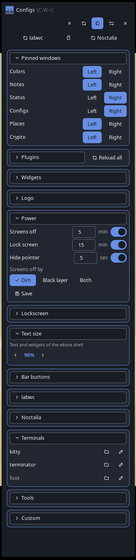
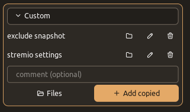
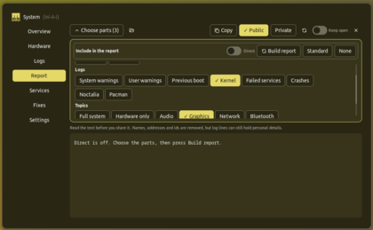
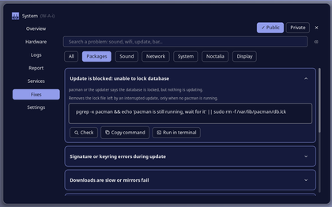
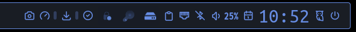
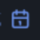
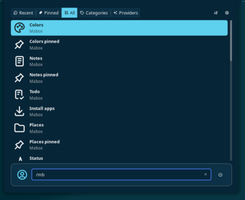
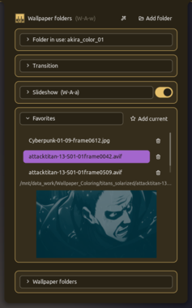
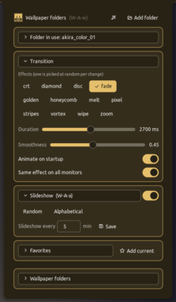

# Guide

What the Noctalia CE session adds on top of Mabox, and how to use it. Hotkeys: [keys.md](keys.md). Tools: [tools.md](tools.md). ISO: [snapshot.md](snapshot.md).

## Configs panel

`C-W-c` opens the Configs panel: quick access to the settings and config files of the session. Each card opens and closes with its header.

- *labwc* and *Noctalia* at the top reload that config.
- *Pinned windows*: pick Left or Right for the panels you pin (Colors, Notes, Status, Configs, Places, Crypto).
- *Plugins*: the Mabox plugins; *Reload all* reloads them.
- *Widgets*: show or hide the desktop widgets.
- *Logo*: switch the Mabox logo.
- *Power*, *Lockscreen*, *Text size*: screen off and lock times, lock screen look, size of text and widgets (see below).
- *Bar buttons*: edit the buttons in the bar (see [Change a bar button](#change-a-bar-button)).
- *labwc*, *Noctalia*, *Terminals*, *Tools*: the config files; the folder icon opens the folder, the pencil opens the file in your editor.
- *Custom*: add your own files to the list (see below).

### Custom files

Add a file you edit often, such as a config of another program.

1. Press **Files**. The file manager opens in `~/.config`.
2. Select the file and copy it (Ctrl+C). The path of the file is now in the clipboard.
3. Type a comment in the field, for example `stremio` (optional).
4. Press **Add copied**. The row is added and the field is empty again.

**Add copied** takes the path from the clipboard. Copy another file first for the next entry.

The row shows the comment, or the file name when there is no comment. Hover the row for the full path.

- Click the comment to change it: type, then press Enter or the check. The x cancels. An empty comment shows the file name again.
- Buttons on the right:

| Button | Does |
|---|---|
| folder | show the file in the file manager (Luciole) |
| pencil | open the file in your editor |
| trash | remove the row; the file stays |

In the dropdown (`W-c`) the card has fields instead: *Name* (optional, default: the file name), *Path* (`~` allowed), *Comment*. **Paste** fills the path with the file you copied; **Add** saves.

## System info

`W-A-i` opens the System panel: *Overview*, *Hardware*, *Logs* (this and the previous boot, kernel, failed services, crashes), *Report*, *Services* and *Fixes*.

*Report* builds one text from the parts you choose.

1. Press *Choose parts* and tick what goes in: *Basics* (Overview, Hardware), *Logs* (system warnings, user warnings, previous boot, kernel, failed services, crashes, Noctalia, pacman) and *Topics* (full system, hardware only, audio, graphics, network, Bluetooth, disks, boot and kernel, packages, power, desktop and Noctalia). *Standard* and *None* set or clear all parts. The choice is remembered.
2. Read the text. It has no user name, host name, IP and MAC addresses, ids, serials and Wi-Fi names.
3. Press *Copy*, or *Save* (to `~/Documents`, or the folder set in *Settings*).

*Direct* (switch in the parts box): on, the report is built again after every change. Off, nothing is collected until you press *Build report*; use this on a slow machine. *Copy* and *Save* come back after *Build report*.

A failed run shows the exit code. Press the refresh icon at the top to run it again.

*Services* lists the system and user services (Failed, Running, All) with a name filter. Open one for its file path, status (scrubbed), *Open folder* and *Edit* (your own file in an editor, otherwise a drop-in, pre-filled with a commented template: remove the `#` of a line to use it, then restart the unit). *Restart*, *Stop*, *Start* and *Reset failed* open a terminal that shows the command and asks y/N first; system units use `sudo` and ask for the unit name instead of y. The *Timers* chip lists your user timers: *Run now* (starts the service), *Start*, *Stop*, *Enable* and *Disable* (both with `--now`) and *Edit*; system timers are not listed. Session-critical units (dbus, systemd-*, login and display managers, polkit, NetworkManager) show status and the folder only; no Edit, Stop or Restart.

*Fixes* lists common problems with a short description. *Check* shows read-only output (scrubbed); *Run in terminal* shows the command, asks before it runs and asks for your password when it needs root.

 

*Public* (default) hides names, addresses and ids, plus the words listed in *Settings*. *Private* shows everything; keep that text to yourself.

## Bar

The bar is noctalia's. Extra buttons:

| Button | Left click | Right click |
|---|---|---|
|  Updates | panel: update all, repo + AUR, repo only, flatpak, snap, npm, pipx, remove orphans (when any), mirrors (pacman-mirrors fasttrack, continent, choose; reflector on plain Arch), check now; `?` button explains the checker, `i` button opens the System panel | check now |
|  Screenshot/rec | area screenshot | Capture panel |
|  Calendar | opens rencal | |

A right-click on the clock opens rencal too.

While a recording runs, the camera <i class="ti">&#xEA54;</i> is a red dot <i class="ti ti-rec">&#xF671;</i>:

| Click | Does |
|---|---|
| left | <i class="ti">&#xED4A;</i> stop |
| right | <i class="ti">&#xED45;</i> pause; click again to resume |

The same dot shows while interval screenshots run; a left click stops them.

A double click on a date in the Noctalia calendar panel opens the default calendar app. The update sets renCal as default when you have no choice yet.

Click the updates button again to close the panel. Flatpak, Snap, npm and pipx entries show only when they have updates.

The RAM button is a noctalia `sysmon` widget: it shows memory use and has no click action.

### Updates

- Counts repo, AUR, flatpak, snap, npm and pipx updates.
- The tooltip shows the split, for example `5 updates (2 repo, 1 AUR, 2 flatpak)`.
- The check runs after login, then every 6 hours, and after every package change.

### Change a bar button

1. Open the Configs panel (or pinned window) and expand *Bar buttons*.
2. Pick a button, edit *Tooltip* or the *Left*, *Middle* and *Right click* fields, press *Save*.

Pinned window: press `alt+s` first, then click a field.

- *Reset* fills the fields from `config.toml`, *Undo* switches back. Nothing changes until *Save*.
- *+ Add button*: fill name, icon and click commands, press *Add to the bar*. The button lands at the end of the bar; move it with the sort button.
- Sort button (next to *+ Add button*): shows an up and a down arrow on each button. An arrow moves the button one place in the bar, past any widget, also into the next bar section. Press the sort button again to hide the arrows.
- *Remove*: takes the button out of the bar. Its settings stay; *+ Add button* with the same name brings it back.

## Theme

One palette drives everything. Change it in the Noctalia settings or with the wallpaper panel: window borders, Geany, PyRadio and Firefox follow.

## Root menu

`A-Space`. Entries: favorites, Mabox Config (settings, control center, wallpaper, edit and reload labwc), applications, running windows, screenshot, screen recording, converter.

Converter: pick a preset, then files; output lands next to the source and never overwrites. Video to MP4 / WebM / MKV / GIF, audio extraction, image formats.

## Launcher

`W-space`. Type to search apps. A prefix limits the search to one provider:

| Prefix | Opens |
|---|---|
| `/mb` | the Mabox tools and panels |
| `/keys` | the hotkey list; Enter runs a bind |
| `/wp` | wallpaper folders |
| `/hist`, `/es` | shell history, Espanso snippets |
| `/music` | music search |
| `/ag` | AI agent sessions |
| `/autostart` | the Autostart panel |

## Screenshots and recording

See [capture.md](capture.md).

## Wallpaper directory

Right-click a folder in pcmanfm → *Set wallpaper dir*.

Set one image: right-click it in pcmanfm → *Set as wallpaper*. The slideshow stops.

Set one image from a folder:
1. Right-click the folder → *Set wallpaper dir*. A running slideshow keeps running.
2. Pick the image in the Noctalia wallpaper chooser.

Saved folders: `W-A-w`, the bar photo button, the *Wallpaper folders* entry in the root menu Mabox Config or `/wp` in the launcher (`/wp list`, `/wp add`). *Add folder* opens a chooser; select a circle to switch. The current folder is listed automatically.

Favorites: *Add current* saves the wallpaper on screen with its theme, a click applies one, the trash button removes it. They are the same favorites as the stars in the Noctalia wallpaper panel. Each card folds with its header.

<table align="center">
<tr>
<td></td>
<td></td>
</tr>
</table>

## Power

Open the Configs panel and expand *Power*: set the minutes until the screens turn off and until the screen locks, and switch each on or off.

- *Screens off by*: *Dim* turns brightness and contrast of every monitor down, *Black layer* covers every monitor with black, *Both* does both. Pick one of them when the screens wake up by themselves.
- The *Lockscreen* card below it sets background, blur, tint and transition of the lock screen.

The *Text size* card in the Configs panel sets the size of text and widgets for the whole shell: `<` and `>` step from 80% to 150%.

In *Configs* → *Widgets*, *Edit layout* opens the desktop widget editor. *Corner radius* (click to open) sets the corner radius of the Mabox desktop widgets: *All* together, or Info, Sysinfo and Todo today one by one with `<` and `>`. Each of those widgets also has *Text size* and *Corner radius* in its own settings. The background rectangle in the widget editor has its own radius.

## Music

See [music.md](music.md).

## Autostart

Add, edit, delay, switch off and remove startup programs, and switch off the shipped defaults. Open it from the root menu or `/autostart`. Changes apply at next login.

## Keep a panel open

The top panels have a **Keep open** switch in the header: Insert, System and Keys.

- Switch it on to keep the panel open when you open another panel.
- Close it with the `x` button. Switch it off to go back to the normal panel.
- The panel has a fixed height while it is kept open.
- The panel hotkey closes the kept copy and opens the normal panel.

Technical details (commands, paths, config files) are in the [technical docs on GitHub](https://github.com/musqz/mabox-noctalia-ce/tree/main/docs/technical).
