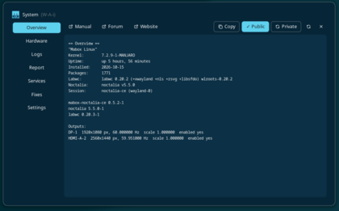
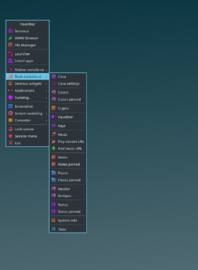
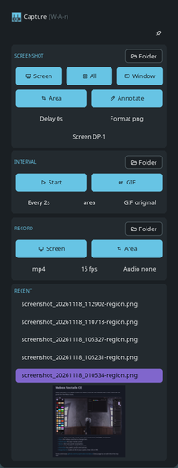
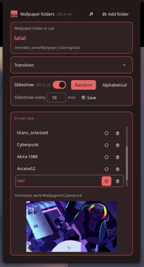
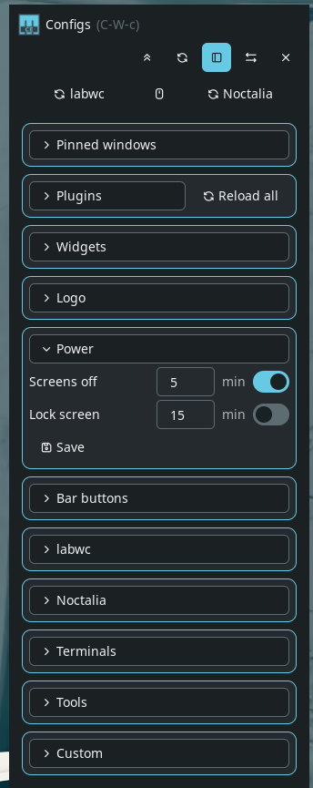
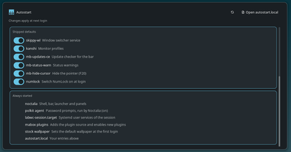

# Guide

What the Noctalia CE session adds on top of Mabox, and how to use it. Hotkeys: [keys.md](keys.md). Tools: [tools.md](tools.md). ISO: [snapshot.md](snapshot.md).

## Where things live

| Path | Content |
|---|---|
| `~/.config/mabox-noctalia-ce/` | labwc config: `rc.xml`, `menu.xml`, `autostart`, `environment`, plugins |
| `~/.config/noctalia/` | noctalia config, theme templates, palettes |
| `~/.local/state/noctalia/settings.toml` | settings saved by the noctalia GUI and `config-set`; overrides `config.toml` |

The repo copy under `configs/` is only the default. Edit the live files under `~/.config/`, or copy the repo version over by hand.

## Configs panel

`C-W-c` opens the Configs panel: quick access to the settings and config files of the session. Each card opens and closes with its header.

<p align="center"><a href="img/configs.png"></a></p>

- *labwc* and *Noctalia* at the top reload that config.
- *Pinned windows*: pick Left or Right for the panels you pin (Colors, Notes, Status, Configs, Places, Crypto).
- *Plugins*: the Mabox plugins; *Reload all* reloads them.
- *Widgets*: show or hide the desktop widgets.
- *Logo*: switch the Mabox logo.
- *Power*, *Lockscreen*, *Text size*: screen off and lock times, lock screen look, size of text and widgets (see below).
- *Bar buttons*: edit the buttons in the bar (see [Change a bar button](#change-a-bar-button)).
- *labwc*, *Noctalia*, *Terminals*, *Tools*: the config files; the folder icon opens the folder, the pencil opens the file in your editor.
- *Custom*: add your own files to the list.

## System info

`W-A-i` opens the System panel: *Overview*, *Hardware*, *Logs* (this and the previous boot, kernel, failed services, crashes), *Report*, *Services* and *Fixes*.

*Report* builds one text from the parts you choose. *Choose parts* ticks what goes in: Overview, Hardware, each log, and topics such as audio, graphics, network, Bluetooth, disks, boot, packages, power or desktop. The choice is remembered. The text has no user name, host name, IP and MAC addresses, ids, serials and Wi-Fi names. Read it, then *Copy* or *Save* (to `~/Documents`, or the folder set in *Settings*).

*Services* lists the system and user services (Failed, Running, All) with a name filter. Open one for its file path, status (scrubbed), *Open folder* and *Edit* (your own file in an editor, otherwise a drop-in, pre-filled with a commented template: remove the `#` of a line to use it, then restart the unit). *Restart*, *Stop*, *Start* and *Reset failed* open a terminal that shows the command and asks y/N first; system units use `sudo` and ask for the unit name instead of y. The *Timers* chip lists your user timers: *Run now* (starts the service), *Start*, *Stop*, *Enable* and *Disable* (both with `--now`) and *Edit*; system timers are not listed. Session-critical units (dbus, systemd-*, login and display managers, polkit, NetworkManager) show status and the folder only; no Edit, Stop or Restart.

*Fixes* lists common problems with a short description. *Check* shows read-only output (scrubbed); *Run in terminal* shows the command, asks before it runs and asks for your password when it needs root.

<p align="center"><a href="img/system-overview.png"></a> <a href="img/system-fixes.png"></a></p>

*Public* (default) hides names, addresses and ids, plus the words listed in *Settings*. *Private* shows everything; keep that text to yourself.

## Bar

The bar is noctalia's. Extra buttons:

<p align="center"></p>

| Button | Left click | Right click |
|---|---|---|
|  Updates | panel: update all, repo + AUR, repo only, flatpak, snap, npm, pipx, remove orphans (when any), mirrors (pacman-mirrors fasttrack, continent, choose; reflector on plain Arch), check now; `?` button explains the checker, `i` button opens the System panel | check now |
|  Screenshot and recording | area screenshot | Capture panel |
|  Calendar | opens rencal | |

A right-click on the clock opens rencal too (`rencal` and `jumpapp` installed). While a recording runs, a stop button appears.

A double click on a date in the Noctalia calendar panel opens the default calendar app. The update sets renCal as default when you have no choice yet. For Thunderbird: `xdg-mime default org.mozilla.Thunderbird.desktop text/calendar`.

Click the updates button again to close the panel. Flatpak, Snap, npm and pipx entries show only when they have updates.

The RAM button is a noctalia `sysmon` widget: it shows memory use and has no click action.

### Updates

- Counts repo, AUR, flatpak, snap, npm and pipx updates. npm and pipx count only when you have user-level global packages.
- Tooltip shows the split: `5 updates (2 repo, 1 AUR, 2 flatpak)`.
- Check runs 30 s after login, then every 6 hours, and after every change to `pacman.log` (offline, no refresh).
- `yay` is used when installed, else `pacman`.
- Snap is skipped in the check and hidden in the menu while `snapd` is stopped.
- Command line: `mb-updates-ce [check|offline|upgrade [all|aur|repo|flatpak|snap|npm|pipx]|orphans|mirrors [fasttrack|continent|all|reflector]|menu]`.

### Change a bar button

1. Open the Configs panel (or pinned window) and expand *Bar buttons*.
2. Pick a button, edit *Tooltip* or the *Left*, *Middle* and *Right click* fields, press *Save*.

Pinned window: press `alt+s` first, then click a field.

- *Reset* fills the fields from `config.toml`, *Undo* switches back. Nothing changes until *Save*.
- *+ Add button*: fill name, icon and click commands, press *Add to the bar*. The button lands at the end of the bar; reorder it in the Noctalia settings.
- *Remove*: takes the button out of the bar. Its settings stay; *+ Add button* with the same name brings it back.

## Theme

One palette drives everything. Change it in noctalia settings or with the wallpaper panel; templates re-render and `labwc -r` reloads.

| Target | Output |
|---|---|
| labwc window borders and titlebars | `~/.local/share/themes/noctalia/openbox-3/themerc` |
| Geany | `colorschemes/noctalia.conf` |
| PyRadio | `themes/mbcolors.pyradio-theme` |
| Firefox (Pywalfox) | `~/.cache/wal/colors.json` |

Add a target: put a template under `~/.config/noctalia/` and a `[theme.templates.user.<name>]` block with `input_path` and `output_path` in `config.toml`. Apply now: `noctalia msg templates-apply`.

## Root menu

`A-Space`. Entries: favorites, Mabox Config (settings, control center, wallpaper, edit and reload labwc), applications, running windows, screenshot, screen recording, converter.

<p align="center"><a href="img/root-menu.png"></a></p>

Converter: pick a preset, then files; output lands next to the source and never overwrites. Video to MP4 / WebM / MKV / GIF, audio extraction, image formats. Command line: `mb-convert <preset> [file...]`.

## Launcher

`W-space`. Type to search apps. A prefix limits the search to one provider:

| Prefix | Opens |
|---|---|
| `/mb` | the Mabox tools and panels |
| `/keys` | the hotkey list; Enter runs a bind |
| `/wp` | wallpaper folders |
| `/hist`, `/es` | shell history, Espanso snippets |
| `/music` | music search |
| `/ag` | AI agent sessions |
| `/autostart` | the Autostart panel |

<p align="center"><a href="img/launcher.png"></a></p>

## Interval screenshots and GIF

`W-A-r` opens the Capture panel: screenshot, interval and record cards, and the recent files. The commands below do the same from a terminal.

<p align="center"><a href="img/capture.png"></a></p>

- `mb-shots-interval [-o OUTPUT|auto | -a] [seconds]` starts: `-o` one monitor (`auto` = `SCREENSHOT_OUTPUT` or the first), `-a` select an area once. Run it again to stop. Files go to `~/Pictures/shot_interval`.
- `mb-shots-interval -b` moves the images to `backup/DATE`; `-x` deletes them; `-n` counts them.
- `mb-gifmaker [-s PIXELS]` turns the images into a GIF in `~/Pictures/Mabox-Animations`. Settings: `~/.config/mabox/mb-gifmaker.conf`.
- Interval settings: `~/.config/mabox/mb-interval-shots.conf` (`interval=`, `screenshot_dir=`).
- `W-S-x` stops a running recording and interval screenshots.
- `mb-screenshot --delay N <screenshot-* args>` waits N seconds first; `--format png|jpg|webp|avif` sets the file type.
- `mb-screenshot screenshot-window` shows the skippy-wl picker: click or `Space` toggles windows, `Enter` confirms. Each picked window is saved as its own file, even when hidden or on another monitor. Without skippy-wl it takes the focused window.
- `screenrec-toggle -o auto` records a whole monitor instead of an area.
- While recording, a red stop button appears next to the `screenrec` bar button; click it to stop.
- Capture pinned window: `mb-pinned capture`; the side is set like for the other plugins.
- Pinned windows: the layout-sidebar button docks one (other windows make room); press it again to float. Saved per plugin in `~/.config/mabox-noctalia-ce/pinned-dock`.

## Wallpaper directory

Right-click a folder in pcmanfm → *Set wallpaper dir*. Command line: `mb-wallpaper-dir <dir>`.

Saved folders: `W-A-w`, the bar photo button, the *Wallpaper folders* entry in the root menu Mabox Config or `/wp` in the launcher (`/wp list`, `/wp add`). *Add folder* opens a chooser; select a circle to switch. The current folder is listed automatically.

<p align="center"><a href="img/wallpaper-folders.png"></a></p>

## Power

<p align="center"></p>

Open the Configs panel and expand *Power*: set the minutes until the screens turn off and until the screen locks, and switch each on or off.

- The settings are written to the Noctalia idle behaviors `screen_off` and `lock`. Change them here, not in the Noctalia settings.
- *Screens off by*: *Dim* sets brightness and contrast of every monitor to 0 over DDC/CI (`ddcutil`), *Black layer* covers every monitor with a black layer, *Both* does both. Without DDC/CI the screens are switched off normally (DPMS).
- Pick *Dim* or *Black layer* when the screens wake up by themselves after switching off, or a monitor keeps showing a power-save icon (seen with a Dell on DisplayPort).
- Input runs `mb-screen-on`: brightness, contrast and the black layer are restored.
- The *Lockscreen* card below it sets background, blur, tint and transition of the lock screen.

The *Text size* card in the Configs panel sets the size of text and widgets for the whole shell: `<` and `>` step from 80% to 150%.

In *Configs* → *Widgets*, *Edit layout* opens the desktop widget editor. *Corner radius* (click to open) sets the corner radius of the Mabox desktop widgets: *All* together, or Info, Sysinfo and Todo today one by one with `<` and `>`. Each of those widgets also has *Text size* and *Corner radius* in its own settings. The background rectangle in the widget editor has its own radius.

## Monitors

- `kanshi` sets positions per profile: `~/.config/kanshi/config`.
- Screenshots of a whole screen use the focused monitor. Set `SCREENSHOT_OUTPUT` (for example `HDMI-A-1`) in `~/.config/mabox-noctalia-ce/environment` to always take the same one; re-login to apply.
- Brightness keys control one output; set `BRIGHTNESS_OUTPUT` (default `HDMI-A-1`).

## Music

See [music.md](music.md).

## Autostart

Add, edit, delay, switch off and remove startup programs, and switch off the shipped defaults. Open it from the root menu or `/autostart`. Changes apply at next login.

<p align="center"><a href="img/autostart.png"></a></p>

## Keep a panel open

The top panels have a **Keep open** switch in the header: Autostart, Agents, Install, Insert, System, Todo and Keys.

- Switch it on to keep the panel open when you open another panel.
- Close it with the `x` button. Switch it off to go back to the normal panel.
- The panel has a fixed height while it is kept open.
- The panel hotkey closes the kept copy and opens the normal panel.

## Import from Mabox Openbox

`mb-import-openbox` copies your Mabox todo setup into CE. Run it once, with `--dry-run` first to see what it would do:

```sh
mb-import-openbox --dry-run
mb-import-openbox
```

Pick one by name: `mb-import-openbox todo` or `mb-import-openbox notes`.

| Section | What it does |
|---|---|
| `todo` | Makes the list that is active in the Mabox todo menu the active list in the Todo panel. The lists themselves are shared: both use `~/.todo`. |
| `notes` | Makes a Notes entry of every Cherrytree node in `~/.todo/<list>.ctb`, tagged with the list. A node is imported once. Only the text comes along: images and tables are left out, and the script says which nodes it skipped. |

Reload the Todo plugin after `todo`: `noctalia msg plugins disable mabox/todo; noctalia msg plugins enable mabox/todo`.

## Tips

- Edited `config.toml` and nothing changed: the state file overrides it. Use `config-get` and `config-set`.
- Reload noctalia config: `noctalia msg config-reload`.
- Restart noctalia: `pkill noctalia; setsid noctalia >/dev/null 2>&1 &`.
- Reload labwc: `C-S-r`.
- Scripts in `bin/` run from `/usr/bin` after a package install. While testing, copy: `sudo install -Dm755 bin/<script> /usr/bin/<script>`.
- Bar widget shows `--`: enable `[system.monitor]`.
- `snap` hangs: start `snapd`, or ignore it; the update check skips it.
- Add, delay, switch off and remove startup programs in the Autostart panel (root menu or `/autostart`). Changes apply at next login. The panel edits `~/.config/mabox-noctalia-ce/autostart.local`; the same file opens in Geany.
- Autostart: `~/.config/mabox-noctalia-ce/autostart`. Personal programs, one per line as `(sleep 5 && tabdock) &` (tabdock, Vorta, PIA VPN, `fittsmon-wl --monitor`) go in `~/.config/mabox-noctalia-ce/autostart.local`; copy the template from `/etc/skel/.config/mabox-noctalia-ce/`.
- Session PATH does not include `~/bin`. Use `~/.local/bin` or an absolute path in binds.
