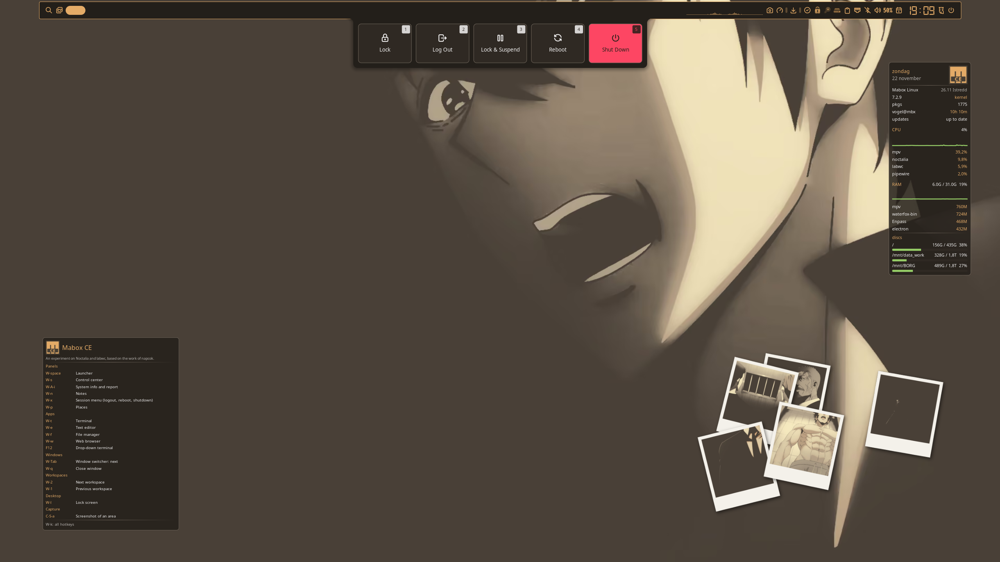

# Mabox Noctalia CE

Mabox Noctalia CE is a labwc session for Mabox Linux with the Noctalia shell: a bar, a launcher and panels for the Mabox tools.

- [Guide](guide.md): system info, bar, theme, root menu, screenshots, wallpaper, power and import from Mabox Openbox.
- [Keys](keys.md): the hotkeys and how to change them.
- [Install apps](install.md): the app installer panel.
- [Music](music.md): the music panel and playlists.
- [Places](places.md): the Places panel, and how it works with Luciole.
- [Sessions](sessions.md): save the open applications and switch between sessions.
- [Tools](tools.md): panels, desktop widgets and scripts.
- [Custom plugins](custom-plugins.md): plugins from users, starting with Ripper.
- [External tools](external-tools.md): jumpapp-ng, skippy-wl, fittsmon-wl and tabdock.
- [Snapshot ISO](snapshot.md): build an ISO of your system, then USB or VM.

## About this project

Mabox Noctalia CE is a hobby project. It builds on the work of Daniel, the developer of Mabox Linux.

It started with a simple idea: take the Mabox tools and bring them to Noctalia. I chose to stay close to Noctalia and use what it already offers.

CE uses neither jgmenu nor conky. Daniel is working on his own Mabox Noctalia session with conky and jgmenu. He has the structure of Mabox in his head, so he can do that part much better than I can. I do not want to duplicate his work. I follow it, react to it and translate it to Wayland and Noctalia.

I build CE with AI help (Claude Code). I started out curious whether it could work, and it turned out to be a good way to make a lot of small tools in a short time. I read and try every change myself before it is merged, and I stay responsible for what ends up in the repo. If something looks off, open an issue.

**Status:** the project has only just begun and is experimental. Things will change, and some parts may break.

Commands, paths and config files are in the [technical docs](https://github.com/musqz/mabox-noctalia-ce/tree/main/docs/technical) on GitHub.

Source and issues: [github.com/musqz/mabox-noctalia-ce](https://github.com/musqz/mabox-noctalia-ce). Every page has an edit link at the top right.
