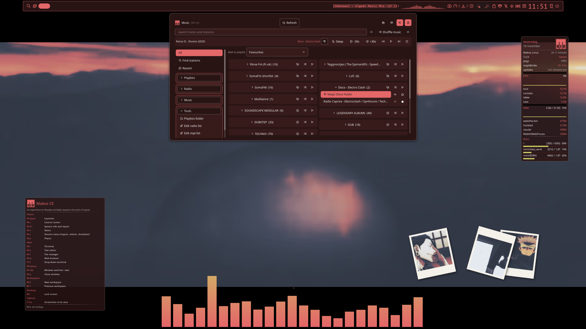

# Mabox Noctalia CE

Mabox Noctalia CE is a labwc session for Mabox Linux with the Noctalia shell: a bar, a launcher and panels for the Mabox tools.

- [Guide](guide.md): system info, bar, theme, root menu, screenshots, wallpaper and power.
- [Keys](keys.md): the hotkeys and how to change them.
- [Install apps](install.md): the app installer panel.
- [Music](music.md): the music panel and playlists.
- [Tools](tools.md): panels, desktop widgets and scripts.
- [Overview](overview.md): files, paths, plugins and services.
- [Snapshot ISO](snapshot.md): build an ISO of your system, then USB or VM.

Source and issues: [github.com/musqz/mabox-noctalia-ce](https://github.com/musqz/mabox-noctalia-ce). Every page has an edit link at the top right.
