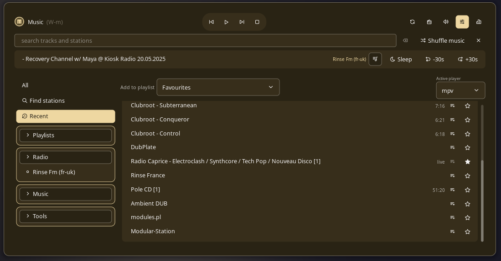
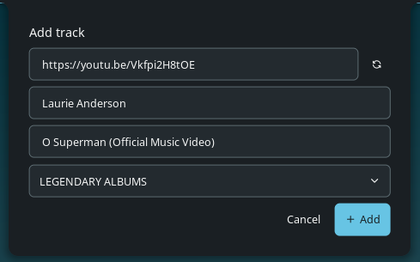

# Music



The `/music` launcher plugin and `mpv-play-stream` read `~/.config/mabox/mb-music/yt_music_list.csv`.

| Key | Tool |
|---|---|
| `W-m` | music panel; `/music` in the launcher does the same search |
| `C-S-2` | add a track to the playlist |
| `C-S-1` | `mpv-play-stream`: play a copied URL in mpv |
| `XF86AudioPlay` / `Stop` / `Next` / `Prev` | `noctalia msg media toggle / stop / next / previous` |

## Setup

`./install.sh` installs the `/music` plugin. By hand:

1. Install `mpv`, `socat`, `yt-dlp`, `mpv-mpris` and `yad`.
2. `noctalia msg plugins source add mabox path /usr/share/mabox-noctalia-ce/plugins`
3. `noctalia msg plugins enable mabox/music`

## Playlist file

One entry per line: `Title,URL`. A line `Category,-` starts a category; `END,-` ends it.

```
Legendary Albums,-
Portishead - Dummy 1994,https://www.youtube.com/watch?v=qNq9TJ4QCas
END,-
```

## Add a track

1. Copy a YouTube or stream URL.
2. Press `C-S-2`.
3. Check Artist and Title (filled from `yt-dlp`), pick a category, press Enter or Add.

<p align="center"><a href="img/add-track.png"></a></p>

The category stays selected until you pick another. Choose "+ New category" to create one.

## Play a URL

1. Copy a video or stream URL.
2. Press `C-S-1`.
3. Press Enter to play it in mpv.

## Use

1. Press `W-m`.
2. Pick a radio group or category in the sidebar, or type to search stations and tracks.
3. Press a row to play it; the shuffle and play buttons on a card start the whole group.
4. Pause, skip and stop with the buttons under the search field, the media keys or the bar media widget.

The icons in the title row open PyRadio, the volume control and the visualiser (right click: Cava settings). *Refresh* shows what plays now and adds it to *Recent*.

The now-playing row has the sleep timer, the play-on switch, `-30s` / `+30s` jump buttons (right click: change the step) and the transport buttons. Tools in the sidebar open the playlists folder, the station and playlist files and radio-browser.info.

Note: `mpv-mpris` exposes mpv to the media keys and bar widget.

## Playlists

Playlists are `.m3u` files in `~/.config/mabox/mb-music/playlists/`; mpv plays them directly.

1. Pick a playlist under *Add to playlist*, or *New playlist...*, type a name and press Enter.
2. Press `+` on a track or station to add it. The star adds it to the Favourites playlist.
3. Open a playlist under *Playlists* in the sidebar to play it, shuffle it, remove tracks (`x`), move a track to the playlist chosen above, or delete it.

Clicking a track in a category or playlist plays the list on from that track and skips streams that fail. The play-on switch in the now-playing row turns that off. *Recent* holds the last 15 tracks that really played; the trash button clears it.

## Track lengths and sleep timer

- The clock button on a card reads the track lengths with yt-dlp and keeps them; a playlist header then shows its total time.
- *Sleep* cycles 15, 30, 60 and 90 minutes, then off; playback stops when it ends.

## Check radio streams

1. Open a radio group.
2. Press the stethoscope button on the card; streams that do not answer turn red.
3. Press *Remove N dead* twice to delete them from `stations.csv`; the old list stays as `stations.csv.bak`. *Keep all* or a right click on a red stream keeps it.

## Find new radio stations

1. Click *Find stations* in the sidebar.
2. Type a name or a genre tag and press Enter.
3. Press the play button of a result to try it.
4. Pick a group under *Add to group* (or *New group...* and type a name) and press *Add*.

The station is appended to `~/.config/pyradio/stations.csv`. Search results come from radio-browser.info.

## Check

- `playerctl -l` lists `mpv.instance-*` while playing.
- `noctalia msg media toggle` pauses and resumes.
