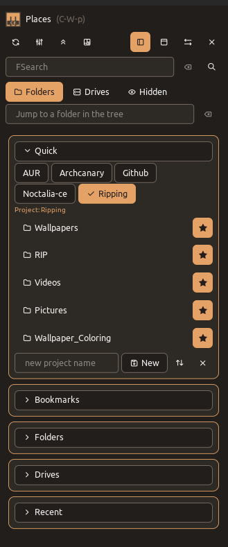
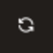
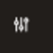
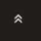
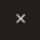

# Places

Folders, drives, bookmarks and recent files in one narrow panel. Pinned at the screen edge it is the sidebar of your file manager.

| Key | Tool |
|---|---|
| `W-p` | Places dropdown; it closes after you open something |
| `C-W-p` | pinned Places window; it stays open |

## Header

| Icon | Does |
|---|---|
|  | Reload the lists |
|  | Show, hide and move the cards; the edit screen lists the buttons |
|  | Close open folders; click again to fold all cards; again to unfold them |
|  | Disk usage (QDirStat) |
|  | Dock: keep windows clear of the panel |
|  | Open as the top panel and close this window |
|  | Move to the other side |
|  | Close |

## Search

- **FSearch field:** type a name, press Enter or the search icon. FSearch opens with your text. The backspace icon clears the field.
- **Jump field:** type part of a folder name. The matching folders open in the cards. Enter goes to the next match.
- **Folders, Drives, Hidden:** pick where the jump field looks: your places and bookmarks, the mounted drives, hidden folders.

On a match: click jumps to it, right click opens it in the file manager, the star adds it to Quick, the copy icon copies the path.

## Cards

| Card | Content |
|---|---|
| Quick | your own project lists |
| Bookmarks | the bookmarks of `~/.config/gtk-3.0/bookmarks` |
| Folders | Home, Desktop, Documents, Downloads, Music, Pictures, Videos, Public, Templates, Trash; a folder that does not exist is left out |
| Drives | partitions that are not system mounts |
| Recent | recently used files |

Click the card title to fold it. In edit mode every card has a switch to hide it and arrows to move it.

### Folders and Bookmarks

- Click a folder to show its content in place. Click again to close it.
- Right click a folder to open it in the file manager.
- Folder buttons: new folder, open in terminal.
- Trash shows the number of items. Its trash icon empties every trash: press it, then press **Empty** within 5 seconds.
- **Network** appears below Trash when Luciole has *Show Network* on (`show_network = true` in `~/.config/luciole/settings.toml`). Press the refresh icon after you change it.

### Quick

1. Type a name in the field, press **New**. The project opens as a button.
2. Press a project button to make it active. Stars appear on every folder and file.
3. Press a star to add the item to the project. Press it again to remove it.

The sort icon shows arrows to reorder the list. The x empties the active list. A folded Quick card shows only the active project.

### Drives

- Click or right click a drive to mount it and open it. A mounted drive shows an arrow to open its folders in place, and an eject icon to unmount it.

### Recent

- Click a file to open it with its default application. Right click opens its folder.
- Press 5, 10, 20 or 50 to pick how many files show.

## Together with Luciole

Luciole is the Noctalia file manager. Run it without its own sidebar and let Places be the sidebar.

1. Set `show_sidebar = false` in the `[browser]` section of `~/.config/luciole/settings.toml`.
2. Pin Places with `C-W-p` and press the dock icon.
3. Click a folder, drive, bookmark or recent file in Places. `mb-files` opens it in Luciole.

- With `single_window = true` in the same file, the next folder opens as a tab.
- Folders is the same list as the Luciole sidebar. Network follows Luciole's switch.
- Places finds a folder anywhere below your places. In Luciole you work inside the folder.
- Without Luciole, `mb-files` opens pcmanfm-qt, else pcmanfm.
