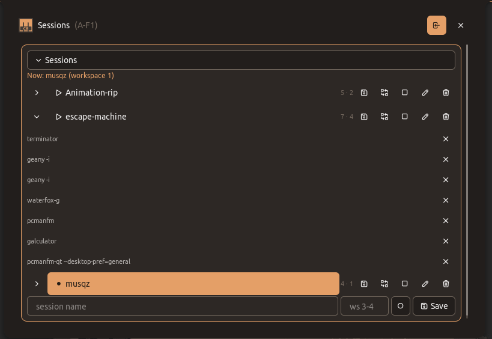

# Sessions

A session is a saved set of applications with the workspace they live on. Start it to get the apps back, switch between sessions without closing anything.

| Key | Tool |
|---|---|
| `A-F1` | Sessions panel |
| root menu → *Sessions* | start a session; the one you are in has a dot |

## Make a session

1. Go to an empty workspace.
2. Press <i class="ti">&#xED47;</i> (New). The open windows are remembered.
3. Open the applications of the session.
4. Type a name, press **Save new**. Only the apps opened after New are saved.

- **Save** without New saves every open window.
- Type `3-4` in the small field to give the session more than one workspace. Without it the session takes the next free workspace.
- Workspaces: set `<desktops number="N"/>` in `rc.xml`. The default is 4.

## Rows

| Icon | Does |
|---|---|
| <i class="ti">&#xEA61;</i> | Show the apps of the session. The x removes an app |
| <i class="ti">&#xED46;</i> **name** | Go to the workspace and start the apps that are not open |
| <i class="ti">&#xEB62;</i> | Save all open windows into the session. Press twice |
| <i class="ti">&#xEBC7;</i> | Replace: save the session you are in, close every window, start this one. Press twice |
| <i class="ti">&#xED4A;</i> | Close the windows of the session's apps. Press twice |
| <i class="ti">&#xEB04;</i> | Rename |
| <i class="ti">&#xEB41;</i> | Delete. Press twice |

- The numbers at the right are the windows in the session and its workspace.
- The line **Now:** and the filled dot <i class="ti">&#xF698;</i> show the session of the workspace you are on. They update when you open the panel.

## Switch

- **Keep everything open:** press the name of the other session. You go to its workspace; nothing is closed or restarted.
- **Clean start:** press <i class="ti">&#xEBC7;</i>. Windows that ask to save stay open.

## At login

Press <i class="ti">&#xEBA7;</i> in the panel header to open the Sessions panel at login. It is off by default. The same switch is in the Autostart panel as *session*.

## Limits

- A session keeps the application and its command line, for example `geany -i file`. Window positions, browser tabs and document contents are not saved.
- Save, Replace and Stop act on windows of every workspace.
- An application without a known command is skipped; the panel names it.
