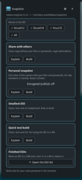
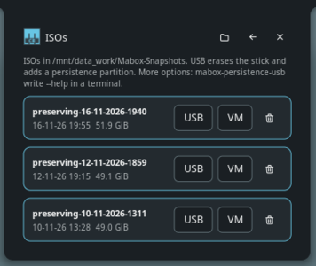

# Snapshot ISO

Build an ISO of your system with the Snapshot panel (`mabox-snapshot`). Open it from the root menu → Mabox noctalia ce → Snapshot, or `/mb snapshot` in the launcher.

 

1. Pick the kernels for the ISO at the top.
2. Pick a profile: *Share with others* (clean copy, login demo/demo), *Personal snapshot* (full clone with your files and passwords, keep it private), *Smallest ISO* or *Quick test build*.
3. *Explain* shows what the profile does. *Build* runs it in a terminal and asks for your sudo password.
4. *Open the ISO list* shows the finished ISOs. *USB* writes one to a stick (this erases the stick and adds a persistence partition). *VM* starts it in quickbox-qt. The trash button deletes the ISO.
