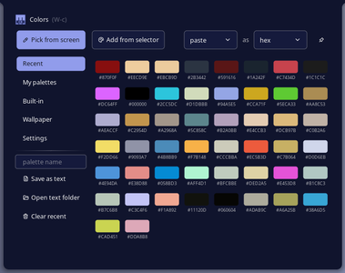
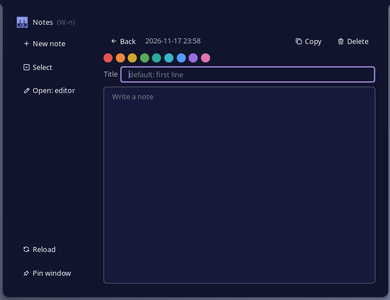
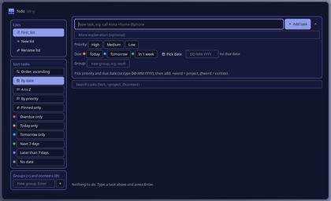
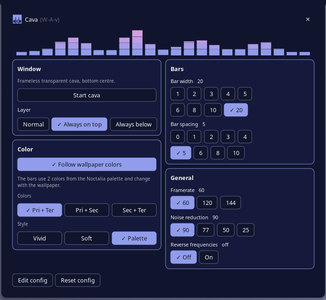
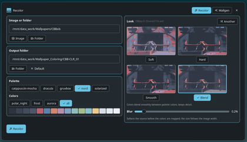
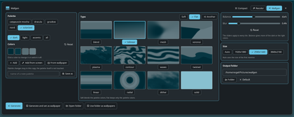
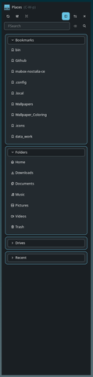
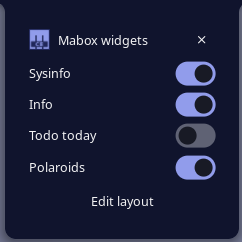

# Tools

Panels, widgets and scripts that Noctalia CE adds. Keys: [keys.md](keys.md).

## Panels

| Tool | Key | Setup |
|---|---|---|
| `mb-colorpick` + Colors bar panel | bar button: pick from screen, recent colors, palettes | `~/.config/colormenu/*.clr` |
| System panel: _overview, hardware, logs, a report built from parts, public or private view, service status and safe restarts, quick fixes_ | `W-A-i` | [guide.md](guide.md#system-info) |
| Keys panel: _hotkey list with search, Basics and All; opens on All binds, with hotkey lists for installed applications; `/keys` in the launcher runs a bind_ | `W-k` | [keys.md](keys.md) |
| Insert: _`/hist` types a shell history line, `/es` an Espanso snippet into the previous window; panel to add and edit snippets_ | `W-A-h`, `W-A-e` | [keys.md](keys.md) |
| Wallpaper folders: _saved list, click to switch the wallpaper directory; `/wp` in the launcher, root menu_ | `W-A-w` | [guide.md](guide.md#wallpaper-directory) |
| Notes panel: _notes with colors_ | `W-n`, pinned window `C-W-n` | `~/.local/state/noctalia/plugins/data/mabox/notes/path`: one line, folder to sync (optional) |
| Places panel: _folders, bookmarks, drives, recent files, FSearch; show, hide and reorder the cards with the edit button_ | `W-p`, pinned window `C-W-p` | bookmarks from `~/.config/gtk-3.0/bookmarks` |
| Status panel: _system info, discs, cleanup rows; the updates bar button turns into a disc warning when a disc is full (`mb-status-warn`)_ | `W-A-s`, pinned window `C-W-s` | settings (gear button) in `~/.local/state/noctalia/plugins/data/mabox/status/settings` |
| Snapshot panel: _profiles to build an ISO with `mabox-snapshot` (Explain in the panel, Build in a terminal with sudo; then USB or VM)_ | root menu → Mabox noctalia ce → Snapshot, `/mb snapshot` | [snapshot.md](snapshot.md): `mabox-snapshot`, `mabox-persistence-usb`, `quickbox-qt` |
| Install apps panel: _pacman-only app list in categories, installed state, Install button (terminal with sudo)_ | `W-i`, root menu, right-click on the launcher button, `/mb install` | [install.md](install.md) |
| Cava panel: _start and stop the transparent cava, bar color, gradient or wallpaper colors, bar width and spacing, framerate, noise reduction_ | root menu → Tools noctalia ce → Cava (start or stop) and Cava settings, `/mb cava` and `/mb cava settings` | `cavactl` (mabox-colorizer) |
| Crypto panel: _amount in a currency converted to LTC, BTC, ETH, XMR, DOGE or SOL at the latest price, offline address check for Litecoin, Bitcoin and Dogecoin_ | root menu → Tools noctalia ce → Crypto, `/mb crypto`, `noctalia msg panel-toggle mabox/crypto:main`; pin button for a pinned window | `mb-crypto` |
| Equalizer panel: _preamp and 10 bands on a PipeWire filter-chain sink, presets, on/off, save as startup values; more presets are `*.json` files in `~/.config/mabox-noctalia-ce/eq-presets/` (`{"name": "...", "gains": [preamp trim, 10 bands]}`), the package ships Adam D3V_ | root menu → Tools noctalia ce → Equalizer, `/mb equalizer`, `noctalia msg panel-toggle mabox/equalizer:main` | `mb-eq` |
| Recolor panel: _recolor an image or a folder to Nord, Gruvbox, Catppuccin Mocha, Dracula or Solarized; soft, hard, smooth or blend look, blur slider, click a color to leave it out; `mb-recolor -b N -x COLORS` on the command line_ | root menu → Tools noctalia ce → Recolor, `/mb recolor`, `noctalia msg panel-toggle mabox/recolor:main` | `mb-recolor`, `magick`, `yad` |
| Wallgen panel: _a wallpaper from a palette or your own colors: twelve types, pattern, angle, balance and blur sliders, a copy of the palette to change, switch off or add colors, Save as your own palette; `mb-wallgen -t TYPE -c COLORS` on the command line_ | root menu → Tools noctalia ce → Wallgen, `/mb wallgen`, `mb-wallgen --panel` | `mb-wallgen`, `magick`, `yad` |

### Previews

<table>
<tr>
<td> Colors</td>
<td> Notes</td>
<td> Todo</td>
</tr>
<tr>
<td> Cava</td>
<td> Recolor</td>
<td> Wallgen</td>
</tr>
<tr>
<td> Places</td>
</tr>
</table>

## Desktop widgets

| Tool | Key | Setup |
|---|---|---|
| Sysinfo desktop widget: _date, system info, CPU/RAM graphs, top processes, discs, updates_ | `noctalia msg desktop-widgets-toggle-edit`, then add *Sysinfo* | needs `[desktop_widgets] enabled = true` |
| Info desktop widget: _logo, About line, basic hotkeys_ | `noctalia msg desktop-widgets-toggle-edit`, then add *Info* | same setting as Sysinfo |
| Polaroids desktop widget: _the previous wallpapers as polaroid thumbnails_ | `noctalia msg desktop-widgets-toggle-edit`, then add *Polaroids* | number of polaroids in the widget settings; needs `magick` |
| Show or hide desktop widgets | root menu *Desktop widgets*, launcher `/mb` *Widgets panel*, or `mb-widget toggle <name>` | bar button: `noctalia msg panel-toggle mabox/tools:widgets`; `mb-widget` lists the names; `W-A-d` hides all |
| Switch the Mabox logo | `mb-logo round`, `square`, `3d`, `ce` or `mb-logo FILE.svg` for your own; `mb-logo` prints the current one | round, square, 3D and CE follow the theme colours; `~/.icons/mabox-logo.svg` points to the chosen file |
| Wallpaper slideshow on or off | root menu → Mabox noctalia ce → Wallpaper slideshow, `W-A-a`, or `mb-slideshow [toggle\|on\|off]` | interval: `noctalia msg config-set wallpaper.automation.interval_seconds <s>` |
| Todo desktop widget: _open tasks that are overdue or due today; click the header to open the panel_ | `noctalia msg desktop-widgets-toggle-edit`, then add *Todo today* | number of tasks in the widget settings |

## Music and media

| Tool | Key | Setup |
|---|---|---|
| music panel | `W-m` | [music.md](music.md) |
| Music: _add track_ | `C-S-2` | [music.md](music.md) |
| `mpv-play-stream` play URL | `C-S-1` | [music.md](music.md) |
| Media keys | `XF86Audio*` | [music.md](music.md) |

## Scripts

| Tool | Key | Setup |
|---|---|---|
| `mb-updates-ce` bar update indicator | left: update panel (Status plugin), right: Status panel | autostart |
| `mb-calendar-setup` local calendar (radicale) | run once in a terminal | Thunderbird + Noctalia Settings > Calendar > Local (vdir) |
